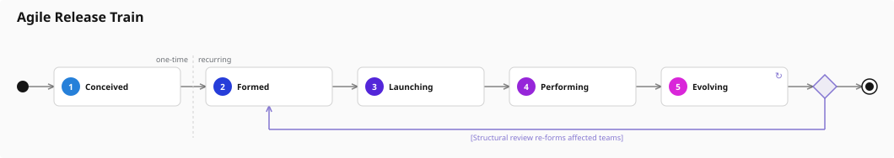

# Alpha State Flow Diagram

## Purpose
Shows an alpha's state model as an activity diagram: the states in sequence, and — where a state declares `loopsBackTo` — the decision and guarded return edge that close a cycle. Rendered above the Alpha State Table in the navigator's main details panel, so the shape of the concern is read before the detail of each state.

Most state models are ladders and draw as a plain chain. A cyclical model is one where reaching the last state means the concern is ready to go round again rather than done (`keleo-language` semantics [6.8](../../deps/language.schema.json)); the figure is what makes that difference visible.

## Data Model
- StateFlowLayout: { width, height, start, nodes: FlowNode[], decisions: Decision[], end, connectors: Connector[], returns: ReturnEdge[], divider, hasLoop, warnings: string[] }
- FlowNode: { index, name, seq, x, y, w, h, colour, loops, loopTargetName, loopEntry, prefix }
- Decision: { fromIndex, cx, cy, r } — one per state that closes a loop
- Connector: { x1, y1, x2, y2, arrows: Line[] }
- ReturnEdge: { fromName, toName, guard, description, channelY, segments: Line[], arrows: Line[], label: { x, w, y } }
- Divider: { x, y1, y2, captionY } — present only when the cycle re-enters after a one-time prefix

## Data Extraction
FUNCTION resolveStateLoops(sortedStates):
  FOR EACH state declaring loopsBackTo:
    Resolve loopsBackTo.stateName against the sibling states
    IF unresolved OR target index >= this index: push a warning, drop the edge
    ELSE record { fromIndex, toIndex, description, condition, guard }
  entryIndex = minimum toIndex across loops (-1 when none)
  RETURN { loops, byStateName, entryNames, entryIndex, warnings }

The guard is `condition.name`, falling back to the first `when` step, then `description`. An unresolvable edge is dropped rather than thrown: validation is what rejects bad data, and a viewer that refuses to draw a practice because one edge is wrong is less useful than one that draws the ladder and says what it could not place.

## Layout
- nodeW: 150, nodeH: 46, gap: 30 (horizontal space carrying the connector and its arrowhead)
- Chain order is `seq` order, so the figure's columns line up with the state table below it
- A decision is placed immediately after each state that closes a loop — that state has two futures — so a model with two cycles draws two decisions
- Return edges route orthogonally through channels below the chain: channelGap 28, channelStep 30, widest span deepest, so a cycle enclosing another does not share its line
- The one-time / recurring divider sits midway between the state before the earliest loop target and the target itself

## Node Shapes
- Start: filled circle, r 7
- State: rounded box with a sequence circle (r 11, the state table's colour ramp) and the state name; `↻` in the top-right corner when the state closes a cycle
- Decision: diamond, half-diagonal 14, loop-coloured outline over a light wash
- End: ring (r 9) around a filled circle

## Edge Paths
Straight orthogonal segments, never curves — the GAS renderer builds every edge from `<line>` elements and two-line arrowheads shared with the relates-to diagram, because the Caja sanitizer is unpredictable with richer SVG. Forward edges are grey; return edges and their guard labels are loop-coloured.

## Colours
- State sequence circles: `hsl(210 + (index / (total - 1)) × 90, 70%, 50%)`, the same ramp as the Alpha State Table
- Forward edges: `#9ca3af` · Return edges, decisions, guards and `↻`: `#8476d1`
- Start and end markers: `#151515` · Divider: `#d2d2d2` dashed

## Example

### ART (Agile Release Train) — a cycle with a one-time prefix



Regenerate with the prototype renderer, which shares the layout body with the navigator:

```bash
node utils/render-state-flow-diagram.mjs <practice.json> --all
```
