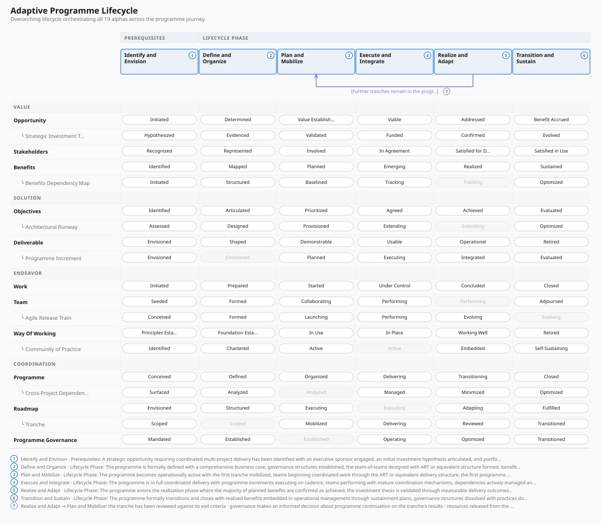

# Pattern Matrix Diagram

## Purpose
Renders a grid where columns are pattern views (lifecycle phases) and rows are alphas. Each cell shows which alpha state is reached in that phase, optionally with activity/activity-space lane chips.

A pattern view is the atomic column unit — the same organising idea the pattern orchestration timeline is built on, where a stage occupies as many columns as its pattern has views. Views as columns is also what makes `PatternView.loopsBackTo` drawable: the language asks for "an arc from a later column back to an earlier one in the pattern matrix" (`keleo-language` semantics 9.2a).

## Data Model
- PatternMatrixCellBlock: { alphaName, stateName, carried, lanes: LaneChip[], sliceInstances? }
- PatternMatrixLaneChip: { laneName, secondary, kind (activitySpace|activity), listOrigin, patternRef }
- PatternMatrixLayout: { width, height, headerY, headerBottom, gridTop, gridBottom, columns, rows, focusBands, cells, narrativeStrips, loops, footnotes, warnings }
- PatternMatrixLoop: { fromName, toName, guard, condition, channelY, segments, arrows, label, note }

## Row Organisation
- buildPatternMatrixAlphaRows: groups alphas by focus (follows focus ordering), returns only ultimate root alphas using findUltimateRootInFocus (walks contributesTo chains)
- Rows within a focus follow baseline declaration order, each root followed by its contributors indented beneath it, so a concern sits where the navigator sidebar puts it
- Restrict the contribution tree to the alphas the pattern references: a contributor whose root is absent, or sits in another focus, becomes a root of its own band
- An alpha a view names but the document does not define still gets a row, in a trailing band, with a warning — the states are the pattern's own statement and dropping them would hide data
- Column ordering follows patternView seq values

## Layout Algorithm
FUNCTION computePatternMatrixLayout(views, alphas, aliasLookup, lanesExpanded):
  Column widths: uniform based on available width
  Header height: max block height across all column headers (includes narrative contexts)
  FOR EACH row (alpha):
    Cell height = max across columns of stacked alpha-state blocks + optional lane arrows
  Row height = max cell height across all columns

Vertical order of bands, top to bottom: narrative strips, column headers, loop channels, then the grid of focus bands and rows.

## Carried-Over States
A state identical to the one the same alpha held in the previous column is **carried over**, not new work, and is drawn muted. It is muted rather than hidden or collapsed to a tick: semantics 9.2a.1 requires a re-entered view to show what the iteration works on even where the state is unchanged, and a reader scanning one column still needs the state named. A carried-over cell stays clickable.

A column that declares no state at all for an alpha is a gap, drawn as a faint mark, and does not reset the carried-over comparison — the next declared state is compared against the last one declared.

## Loop Channels
`PatternView.loopsBackTo` draws as an orthogonal return edge in a channel **between the column headers and the grid**, so it stays beside the phases it spans however tall the grid grows — a nineteen-row pattern would otherwise put the arc a thousand pixels from the columns it refers to.

- Resolve `patternViewName` against sibling views. Drop the edge with a warning when the target is missing or its `seq` is not lower; the matrix still renders.
- Each edge runs from the closing column's centre down into its channel, left, then up into the target column's header, with a two-line arrowhead.
- Channel depth is assigned by span, widest deepest, so a cycle enclosing another does not share its line.
- The edge is labelled with the guard — `condition.name`, falling back to the first `when` step, then `description`. The scenario behind it reads as prose and goes to the footnotes.

## Narrative Strips
Where the pattern declares a `narrativeTypeName`, each narrative element spans the columns whose `narrativeContexts` name it, packed into rows by first fit. The strip carries the element name only; the context paragraph goes to the footnotes, the same split the orchestration diagram makes for entry and exit criteria.

## Block Measurement
- computeBlockHeightForWidth: nameLineH=18, descLineH=16, gap=8, y0=padY+22, bottomPad=22
- computeArrowHeightForWidth: minimum height 74
- Text wrapping: nameMaxChars = floor(contentWidth/8), descMaxChars = floor(contentWidth/7)

## Swimlane Focus Headings
- padTop: 18, nameLineH: 20, descLineH: 16, nameDescGap: 6, padBottom: 12, minHeight: 52
- Supports aliased name display (primary, primaryWithCanonical, canonicalContinuation rows)
- Suppressed when every row falls in one focus, where a single heading says nothing

## Lane Toggle
- LANE_TOGGLE_HEIGHT: 22
- Interactive: lanes can be expanded/collapsed
- Static/PDF: lanes always shown
- Not implemented by the Keleo Studio GAS navigator, which renders states only

## Example

### Adaptive Programme Lifecycle

Six phases across nineteen concerns in four focus bands, with the return edge from Realize and Adapt to Plan and Mobilize.



Regenerate from a bundle with the prototype renderer, which shares its layout body with the GAS navigator:

```bash
node utils/merge-practice.mjs <bundle.keleo> "<method name>" --out merged.json --quiet
node utils/render-pattern-matrix.mjs merged.json --all
```
